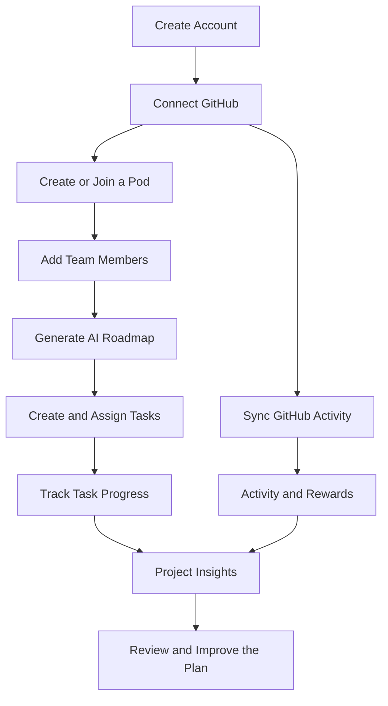
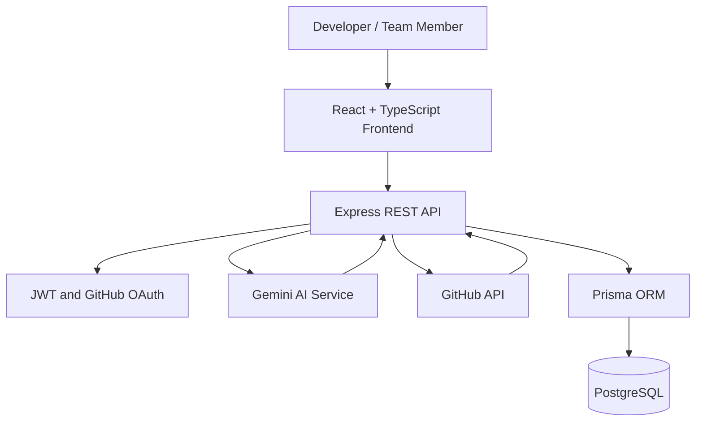

# OrbiVAI 

<div align="center">
  
  
  
  
  
</div>
<br />

> **From GitHub activity to AI-powered team execution.**

OrbiVAI is an AI-assisted collaboration platform designed to help small engineering teams plan projects, organize development work, understand team activity, and turn progress into actionable insights.

It brings together project workspaces called Pods, GitHub integration, AI-generated development roadmaps, task management, team activity tracking, and developer rewards in one workspace.

Instead of managing project plans, assignments, development activity, and team progress in disconnected places, OrbiVAI aims to create a more connected development workflow.

- **Live application:** [https://orbivai-six.vercel.app](https://orbivai-six.vercel.app/)
- **Repository:** [https://github.com/Komalgiri/codepods-backend](https://github.com/Komalgiri/codepods-backend)

---

## 📌 Table of Contents
- [The Problem](#-the-problem)
- [Our Approach](#-our-approach)
- [Core Features](#-core-features)
- [How OrbiVAI Works](#-how-codepods-works)
- [Architecture](#-architecture)
- [Technology Stack](#-technology-stack)
- [Database Design](#-database-design)
- [API Reference](#-api-reference)
- [Getting Started](#-getting-started)
- [Environment Variables](#-environment-variables)
- [Running with Docker](#-running-with-docker)
- [Security Considerations](#-security-considerations)
- [Current Limitations](#-current-limitations)
- [Roadmap](#-roadmap)
- [Contributing](#-contributing)
- [Author](#-author)

---

## 🎯 The Problem
Software development involves more than writing code. Teams must decide what to build, divide work, coordinate responsibilities, track progress, review contributions, and identify blockers.

These activities often become fragmented across project management tools, GitHub repositories, team conversations, and individual task lists.

This creates several challenges:
- **Disconnected planning and execution:** Project plans may not reflect the work actually happening in the codebase.
- **Manual coordination:** Team members need to repeatedly update task boards and communicate progress.
- **Limited project visibility:** It can be difficult to understand contribution patterns, workload, and potential blockers.
- **Unclear task ownership:** Teams need a reliable way to assign work and follow it through completion.
- **Generic planning:** Project roadmaps often require considerable manual effort before they become useful.
- **Low engagement:** Small teams and collaborative learning groups may benefit from visible progress and recognition.

OrbiVAI explores how AI-assisted planning, GitHub activity, collaborative workspaces, and transparent progress tracking can help address these challenges.

---

## 💡 Our Approach
OrbiVAI is built around the idea that planning, execution, and team progress should be connected.

A team creates a Pod for a project, brings its members together, connects GitHub, organizes tasks, and uses AI-assisted planning to establish a development direction.

As work progresses, the platform can collect GitHub activity and display team metrics, tasks, rewards, and insights in the same workspace.

**The intended workflow is:**
1. Create a project workspace.
2. Invite or add collaborators.
3. Connect GitHub and retrieve relevant development activity.
4. Generate an AI-assisted roadmap using project and team context.
5. Create, assign, and update tasks.
6. Review activity, progress, achievements, and team contributions.
7. Use the accumulated project context to improve future planning.

The long-term goal is to reduce the gap between what a team intends to build and what it is actually delivering.

---

## ✨ Core Features

### 1. Collaborative Pods
Pods are the central collaboration unit in OrbiVAI. Each Pod represents a project or collaborative engineering effort.

The data model supports:
- Pod names and descriptions.
- Project membership and individual roles.
- Member invitation and join-request workflows.
- Membership status.
- Project-specific tasks and activity.
- GitHub repository associations.
- AI-generated roadmaps and stored project context.

The backend includes membership and role-management endpoints, while the frontend includes Pod creation, exploration, overview, and task-board pages.

### 2. GitHub Integration
OrbiVAI connects user accounts with GitHub to bring development activity into the collaboration workflow.

The integration includes:
- GitHub OAuth login and account linking.
- Retrieval of user repositories.
- Commit retrieval for selected repositories.
- Synchronization of GitHub activity.
- Developer profile analysis.
- Inferred developer roles and technology stacks.
- Activity records that can contribute to reward calculations.

The backend uses GitHub API access through Octokit and Axios. The current implementation includes repository and commit synchronization, with the service structured to support additional event types. The accuracy and completeness of this synchronization depend on the current API implementation, OAuth permissions, and pagination handling.

### 3. AI-Powered Development Roadmaps
OrbiVAI integrates the Google Gemini API to generate strategic project plans.

The roadmap generation process can use:
- Project name and description.
- Pod membership and roles.
- Member technology stacks.
- Recent project activity.
- Existing tasks and their statuses.
- Previously stored project context.

The AI controller also supports cached roadmaps and project insights. Roadmaps are stored in the database so the application does not need to regenerate them on every request.

*The current implementation includes permission checks for roadmap generation and a seven-day cache policy, with administrators able to request regeneration under the defined conditions. AI output should be treated as a planning aid rather than an authoritative source. Generated assignments, task suggestions, and project insights require appropriate validation before they are relied upon.*

### 4. Task Management
The task system connects project planning to day-to-day execution.

Supported backend capabilities include:
- Creating tasks within a Pod.
- Assigning tasks to Pod members.
- Recording task descriptions and due dates.
- Tracking task status.
- Recording task completion times.
- Notifying users when tasks are assigned.
- Restricting task updates according to membership and role rules.

The task model currently supports three statuses: `pending`, `in-progress`, `done`.
The frontend includes a task board and AI planning interface intended to help users move from generated plans to actionable work.

### 5. Developer Rewards and Gamification
OrbiVAI includes a reward system intended to recognize contributions and make progress more visible.

The current data model supports:
- Reward points.
- Reward reasons.
- Badge identifiers.
- Activity-based point values.
- Pod leaderboards.
- Achievement views.

The GitHub integration includes activity-to-reward logic, with activity categories such as commits and repository creation represented in the implementation documentation.

*The broader product opportunity is to recognize meaningful collaboration, not simply reward the highest number of commits. Reward accuracy and resistance to gaming are important areas for future improvement.*

### 6. Team Activity and Insights
The backend stores project activity and provides endpoints for activity feeds and statistics.

The application also maintains developer-profile fields such as:
- Technology stack.
- Inferred developer role.
- Role-analysis data.
- Reliability score.
- Team-dynamics metrics.

Task completion logic records completion times and contributes to metrics such as on-time completion, missed deadlines, and task-rescue activity.

*These metrics are intended to help teams understand execution patterns. They should be interpreted as operational signals, not definitive measures of an individual's ability or performance.*

### 7. Notifications
OrbiVAI has a notification model and backend routes for delivering application notifications.

Notifications can include a title, message, type, optional destination link, read status, and creation time. For example, the task controller creates a notification when a task is assigned to another user.

### 8. Authentication and Account Management
The application supports:
- Email and password registration.
- Email and password login.
- Password hashing with bcryptjs.
- JWT-based authenticated requests.
- GitHub OAuth.
- User profile retrieval and updates.
- User search.

The frontend includes authentication screens, a GitHub connection flow, and protected routes.

---

## 🔄 How OrbiVAI Works
The following diagram describes the intended high-level workflow.



**Example workflow:**
Imagine a small team building a SaaS application.
1. The team creates a Pod called "Customer Portal".
2. The team connects its GitHub accounts and relevant repository.
3. OrbiVAI uses the project description, team information, activity, and existing tasks to generate a suggested roadmap.
4. The team reviews the roadmap and creates tasks for frontend development, API implementation, and testing.
5. Members update task statuses as the work progresses.
6. GitHub activity is synchronized to the platform.
7. The team reviews project activity, task completion, rewards, and available insights.
8. The team remains responsible for deciding priorities and accepting or rejecting AI-generated recommendations.

---

## 🏗️ Architecture
OrbiVAI is organized as a full-stack application with separate frontend and backend applications.



### Frontend
**Location:** `frontend/`

The frontend is built with React, TypeScript, and Vite. It contains application pages, reusable components, navigation, authentication flows, and services for communicating with the backend.

**Important pages include:**
- `Auth.tsx` — authentication interface.
- `AuthCallback.tsx` — OAuth callback handling.
- `CreatePod.tsx` — Pod creation.
- `ExplorePods.tsx` — Pod discovery.
- `PodOverview.tsx` — project workspace overview.
- `PodTaskBoard.tsx` — task management.
- `AIPlanningAssistant.tsx` — AI-assisted planning.
- `GitHubActivity.tsx` — GitHub activity.
- `PodRewards.tsx` — reward views.
- `UserDashboard.tsx` — user dashboard.
- `UserProfile.tsx` — user profile.

### Backend
**Location:** `backend/`

The backend uses Express to expose REST endpoints, controllers to handle application operations, middleware for authentication and request protection, services for external integrations, and Prisma for database access.

**Important directories:**
```text
backend/
├── prisma/
│   └── schema.prisma
└── src/
    ├── controllers/
    ├── middleware/
    ├── routes/
    ├── services/
    ├── utils/
    └── index.js
```

- `controllers/` contains business logic for users, Pods, tasks, rewards, notifications, GitHub, and AI planning.
- `routes/` defines the API endpoints.
- `middleware/` contains authentication, validation, and rate-limiting logic.
- `services/` contains GitHub activity integration.
- `utils/` contains shared utilities such as Prisma client configuration and encryption.

### Data layer
Prisma defines the relational data model and provides database access. PostgreSQL stores user accounts, Pods, memberships, tasks, activity, rewards, skills, and notifications.

### External services
- **GitHub:** Authentication and development activity.
- **Google Gemini:** AI-assisted roadmap generation and task suggestions.
- **PostgreSQL hosting:** Configured through `DATABASE_URL`.

---

## 🛠️ Technology Stack

| Category | Technology |
| --- | --- |
| Frontend framework | React 18 |
| Language | TypeScript and JavaScript |
| Frontend build tool | Vite |
| Routing | React Router |
| Styling | Tailwind CSS |
| Animations | Framer Motion |
| Backend framework | Express 5 |
| Runtime | Node.js |
| Database | PostgreSQL |
| ORM | Prisma 6 |
| Authentication | JWT, bcryptjs, GitHub OAuth |
| AI integration | Google Gemini API |
| GitHub integration | Octokit, Axios |
| Security | Helmet, CORS, rate limiting, request validation |
| Container support | Docker and Docker Compose |
| Frontend deployment configuration | Vercel |

---

## 🗃️ Database Design
The Prisma schema defines the core entities and their relationships.

| Model | Purpose |
| --- | --- |
| User | Account information, GitHub connection, technology stack, role analysis, and team metrics |
| Pod | Project workspace, members, tasks, repository association, and AI planning context |
| PodMember | Connects users to Pods and records roles and membership status |
| Task | Project work, assignment, status, due date, and completion metadata |
| Activity | Records development or project activity and its associated metadata |
| Reward | Stores points, reasons, and badge identifiers |
| Badge | Defines available badges and their descriptions |
| Skill | Represents skills associated with users |
| Notification | Stores user-facing notifications and read status |

**Relationships:**
- A user can belong to multiple Pods.
- A Pod can have multiple members.
- A Pod can contain multiple tasks and activity records.
- Tasks can optionally be assigned to users.
- Users can earn rewards and accumulate activity records.
- Users can associate themselves with multiple skills.
- Users can receive multiple notifications.

*The `PodMember` model enforces a unique combination of `userId` and `podId`, preventing duplicate membership records for the same user and Pod.*

---

## 🌐 API Reference
The backend exposes REST endpoints under `/api`. The following list summarizes the routes found in the current route files. It is not a substitute for endpoint-by-endpoint integration testing.

### Authentication and users
**Base path:** `/api/users`

| Method | Endpoint | Purpose |
| --- | --- | --- |
| POST | `/signup` | Register with email and password |
| POST | `/login` | Authenticate with email and password |
| GET | `/profile` | Retrieve the authenticated user's profile |
| PATCH | `/profile` | Update the user's profile |
| GET | `/search?q=...` | Search users |
| GET | `/:id/rewards` | Retrieve the authenticated user's rewards |

### GitHub OAuth
**Base path:** `/api/auth/github`

| Method | Endpoint | Purpose |
| --- | --- | --- |
| GET | `/login` | Start GitHub OAuth |
| GET | `/callback` | Handle the OAuth callback |

### Pods
**Base path:** `/api/pods`

| Method | Endpoint | Purpose |
| --- | --- | --- |
| GET | `/` | List the authenticated user's Pods |
| GET | `/public` | Retrieve Pods for exploration |
| POST | `/` | Create a Pod |
| POST | `/create` | Backward-compatible Pod creation route |
| GET | `/:id` | Retrieve Pod details |
| PATCH | `/:id` | Update a Pod |
| POST | `/:id/members` | Add a member |
| PATCH | `/:id/members/:memberId` | Update a member's role |
| POST | `/:id/request` | Request to join a Pod |
| POST | `/:id/join` | Respond to a join or invitation workflow |
| POST | `/:id/leave` | Leave a Pod |
| DELETE | `/:id` | Delete a Pod |
| POST | `/:id/sync` | Synchronize Pod activity |
| GET | `/:id/tasks` | List tasks for a Pod |
| POST | `/:id/tasks` | Create a task |
| GET | `/:id/activities` | Retrieve Pod activity |
| GET | `/:id/stats` | Retrieve Pod statistics |
| GET | `/:id/leaderboard` | Retrieve the Pod leaderboard |
| GET | `/:id/achievements` | Retrieve Pod achievements |

### Tasks
**Base path:** `/api/tasks`

| Method | Endpoint | Purpose |
| --- | --- | --- |
| PATCH | `/:id/status` | Update task status |

### GitHub activity
**Base path:** `/api/github`

| Method | Endpoint | Purpose |
| --- | --- | --- |
| GET | `/repos` | Retrieve repositories for the connected account |
| GET | `/commits` | Retrieve commits for a repository |
| POST | `/sync` | Synchronize GitHub activity |
| POST | `/analyze` | Analyze the connected GitHub profile |

### AI planning
**Base path:** `/api/ai`

| Method | Endpoint | Purpose |
| --- | --- | --- |
| GET | `/pods/:id/plan` | Retrieve or generate a Pod roadmap |
| POST | `/pods/:id/suggest-tasks` | Request AI task suggestions |

### Rewards
**Base path:** `/api/rewards`

| Method | Endpoint | Purpose |
| --- | --- | --- |
| POST | `/` | Create a reward; the controller restricts manual awarding to global administrators |

### Notifications
**Base path:** `/api/notifications`
The notification route module is registered in the application. Refer to `backend/src/routes/notificationRoutes.js` for the exact methods and paths.

**Authentication requirements:**
Most application endpoints require a JWT using the authorization header:
`Authorization: Bearer YOUR_JWT_TOKEN`
The backend also applies rate limiting to API routes, with stricter limiters for authentication, search, AI operations, and synchronization.

---

## 🚀 Getting Started

### Prerequisites
Install the following before starting development:
- Node.js and npm.
- Git.
- PostgreSQL, either locally or through a hosted provider.
- A GitHub OAuth application.
- A Google Gemini API key.

### 1. Clone the repository
```bash
git clone https://github.com/Komalgiri/codepods-backend.git
cd codepods-backend
```

### 2. Configure the backend
```bash
cd backend
npm install
```
Create a `.env` file in the `backend/` directory, using `.env.example` as a reference. Configure the database connection, JWT secret, GitHub OAuth credentials, encryption key, Gemini API key, frontend URL, and environment mode.

### 3. Generate the Prisma client and prepare the database
```bash
npx prisma generate
npx prisma migrate deploy
```
*Use `prisma migrate deploy` only when the repository's migration history is present and configured for the target database. If the repository has no applicable migrations, review the schema and establish the correct development migration workflow before proceeding.*

### 4. Start the backend
```bash
npm run dev
```
The backend defaults to port `5000`, unless the `PORT` environment variable overrides it. Visit `http://localhost:5000/` to check the root health response.

### 5. Configure the frontend
Open a second terminal:
```bash
cd codepods-backend/frontend
npm install
```
Configure the frontend API URL using the environment variable expected by the frontend services. The repository's Docker configuration uses `VITE_API_URL`; verify the frontend service implementation before choosing the exact local value.
For example, a local configuration may point to:
`VITE_API_URL=http://localhost:5000`

### 6. Start the frontend
```bash
npm run dev
```
Vite will print the local development URL in the terminal.

### 7. Build and lint the frontend
```bash
npm run build
npm run lint
```
These commands are defined in the frontend's `package.json`. The backend also provides build and start scripts.

---

## 🔐 Environment Variables
Create environment files locally. **Never commit real credentials, OAuth secrets, production database URLs, or encryption keys.**

**Backend `.env`**

| Variable | Purpose |
| --- | --- |
| `DATABASE_URL` | PostgreSQL connection string |
| `JWT_SECRET` | Secret used to sign and verify JWTs |
| `ENCRYPTION_KEY` | Key used by the GitHub-token encryption utility |
| `GITHUB_CLIENT_ID` | GitHub OAuth application ID |
| `GITHUB_CLIENT_SECRET` | GitHub OAuth application secret |
| `GEMINI_API_KEY` | Google Gemini API key |
| `FRONTEND_URL` | Allowed frontend origin and OAuth redirect destination configuration |
| `NODE_ENV` | Environment mode, such as development or production |
| `PORT` | Optional backend listening port |

**Frontend environment**

| Variable | Purpose |
| --- | --- |
| `VITE_API_URL` | Backend API base URL used by the frontend, as configured in the deployment setup |

*Important: Environment variables exposed through the frontend build must never contain private credentials. Keep GitHub client secrets, JWT secrets, database credentials, Gemini keys, and encryption keys on the server.*

---

## 🐳 Running with Docker
The repository includes a `docker-compose.yml` file with services for:
- The Express backend.
- The frontend.
- An optional PostgreSQL database.

Review the Compose file before using it. In particular, replace the sample database password, configure secrets outside version control, confirm the frontend API URL and CORS origin, and avoid exposing database ports unnecessarily.

Once the environment is configured, start the services from the repository root:
```bash
docker compose up --build
```
Stop the services with:
```bash
docker compose down
```
For a persistent local database, Docker Compose defines a named PostgreSQL volume. Production deployments should use separate environment-specific settings, managed credentials, secure database access, and appropriate network configuration.

---

## 🔒 Security Considerations
OrbiVAI contains several important security mechanisms, including JWT authentication, password hashing, Helmet, CORS restrictions, rate limiting, input-validation middleware, and GitHub-token encryption utilities.

Before production or commercial deployment, the following areas require particular attention:
- **OAuth state validation:** Use a cryptographically secure, session-bound OAuth state value to protect the authorization flow against request forgery.
- **GitHub token handling:** Verify that tokens are encrypted at rest, never logged, and never returned to clients. Use the minimum GitHub permissions required.
- **Authorization:** Validate access to each Pod, task, reward, and user record on the server. Do not rely on frontend restrictions.
- **AI output validation:** Validate generated JSON, assignee IDs, task statuses, and any other model-generated values before storing them.
- **Activity integrity:** Deduplicate GitHub events using stable identifiers and database constraints where appropriate.
- **Privacy:** Clearly explain what repository information is collected, how it is used, and who can see it.
- **Operational monitoring:** Add structured logging, error monitoring, backups, and tested recovery procedures.
- **Secrets management:** Rotate exposed credentials and keep all production secrets out of Git history.

*This section describes important safeguards and areas for hardening; it should not be interpreted as a claim that the system has passed a comprehensive security audit.*

---

## ⚠️ Current Limitations
The repository includes implementation notes identifying issues that should be addressed as the project evolves. Examples include:
- GitHub synchronization requires reliable pagination and deduplication.
- GitHub language and role analysis can be improved with language-byte weighting, framework detection, and recency-aware signals.
- AI-generated task assignments need stronger validation against actual Pod membership.
- Activity statistics should use the real event timestamp rather than the database synchronization timestamp.
- Team-matching percentages should be based on transparent, explainable calculations rather than random fallback values.
- Reward calculations should recognize meaningful contributions and account for duplicate or reversed events.
- Errors from external APIs should be surfaced, logged consistently, and monitored.

*The repository's `ANALYSIS_LOOPHOLES.md` provides additional implementation-specific findings. Verify the current code and tests before treating any documented issue as fixed or any feature as fully production-ready.*

---

## 🗺️ Roadmap
The following is a proposed roadmap for the project, not a claim that these features are already implemented.

**Reliability and security**
- Fix and test GitHub synchronization edge cases.
- Improve pagination, retries, rate-limit handling, and event deduplication.
- Strengthen OAuth state validation and secret management.
- Add API integration tests and authorization tests.
- Validate AI output against explicit schemas.
- Add monitoring and operational error reporting.

**AI and project intelligence**
- Improve roadmap quality using repository structure and actual project context.
- Validate and explain AI-generated task assignments.
- Detect duplicate or already-completed task suggestions.
- Improve skill and role inference using stronger evidence.
- Track roadmap progress against verified development events.

**Collaboration**
- Improve project invitations and membership workflows.
- Strengthen task dependencies and milestone management.
- Add richer project-level activity reporting.
- Improve notification preferences and delivery reliability.

**Product readiness**
- Conduct usability testing with real engineering teams.
- Establish a clear privacy and data-retention policy.
- Document deployment and recovery procedures.
- Validate a repeatable onboarding experience.
- Test pricing and willingness to pay with early adopters.

---

## 🤝 Contributing
Contributions, bug reports, and suggestions are welcome.
1. Fork the repository.
2. Create a feature branch.
3. Make focused changes and add tests where appropriate.
4. Run the available lint and build commands.
5. Submit a pull request describing the problem, implementation, and verification steps.

*Please avoid committing real environment files, credentials, or private user data.*

---

## 📧 Support
For support, technical issues, or questions about the GitHub Developer Program integration, please contact us at: **support@orbivai.com**

---

## 📄 License
Review the repository's licensing status before redistributing or using OrbiVAI commercially. A package-level license declaration does not necessarily establish a license for the entire repository. Add a clear root-level LICENSE file before inviting external contributions or distributing the project under an open-source license.

---

## 👩‍💻 Author
**Komal Giri**
- **GitHub:** [https://github.com/Komalgiri](https://github.com/Komalgiri)
- **Portfolio:** [https://portfolio-komalgiri.onrender.com](https://portfolio-komalgiri.onrender.com/)
- **LinkedIn:** [https://www.linkedin.com/in/komal-giri-52798a265/](https://www.linkedin.com/in/komal-giri-52798a265/)

*OrbiVAI — connect planning, code, and collaboration in one development workspace.*
